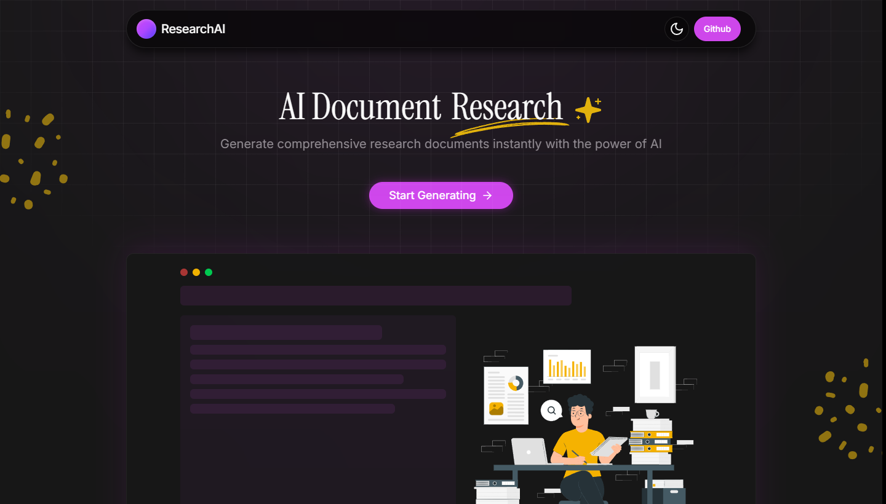
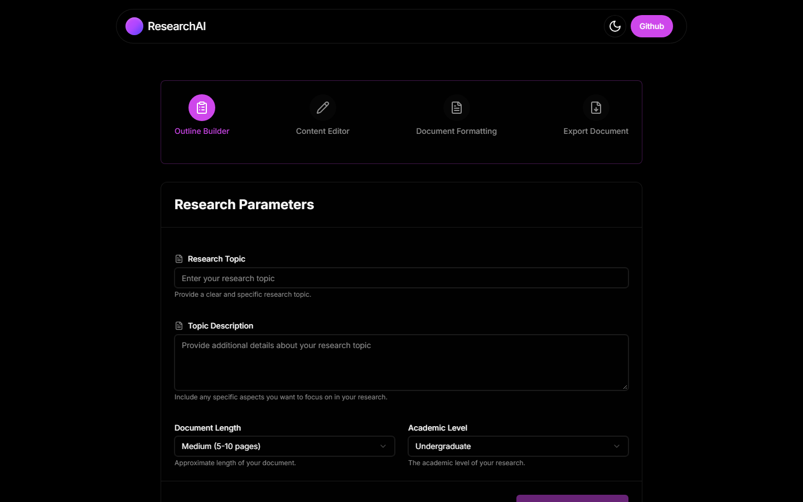
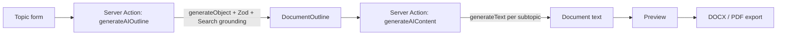

<div align="center">

# ResearchAI

**Generate a complete, submission-ready research document from a single topic — outline, content, and export.**

[](https://nextjs.org)
[](https://react.dev)
[](https://www.typescriptlang.org)
[](https://tailwindcss.com)
[](https://ai.google.dev)
[](https://sdk.vercel.ai)
[](#-license)
[](https://researchai-steel.vercel.app)

**🔗 Live demo:** [researchai-steel.vercel.app](https://researchai-steel.vercel.app)

[Features](#-features) · [Tech stack](#-tech-stack) · [Getting started](#-getting-started) · [Project structure](#-project-structure) · [Deployment](#-deployment) · [العربية](#-نبذة-بالعربية)

</div>



---

## 📖 Overview

ResearchAI turns a research topic into a structured academic document. It generates a section/subtopic outline grounded with Google Search, writes each subtopic with an academic tone matched to the requested level, previews the result as a formatted paper, and exports it to **DOCX** or **PDF**.

Built for students, researchers, and professionals who need a solid first draft they can edit — not a blank page.

| Step | Screen | What happens |
| :--: | :----- | :----------- |
| 1 | **Outline Builder** | Describe the topic, pick length and academic level → AI builds sections and subtopics |
| 2 | **Content Editor** | Generate content per subtopic or all at once, regenerate anything, track progress |
| 3 | **Document Formatting** | Live paper preview with cover page and table of contents |
| 4 | **Export Document** | Download as `.docx` or `.pdf`, ready for submission |



---

## ✨ Features

- **AI outline generation** — structured sections (Introduction, Literature Review, Methodology, Results, Discussion, Conclusion) with 2–4 non-overlapping subtopics each, grounded via Gemini `useSearchGrounding`.
- **Fine-grained control** — document length (1–20 pages), academic level (High School → Doctoral), topic description, and per-section/per-subtopic selection.
- **Section-by-section writing** — generate one subtopic, regenerate it, or batch-generate every selected subtopic with a live progress bar.
- **Editing before export** — toggle sections and subtopics in or out of the final document.
- **Professional preview** — cover page, table of contents, numbered sections, and paper-style typography.
- **Real file export** — `.docx` (via `docx`) and `.pdf` (via `jsPDF`), generated fully client-side.
- **Polished UX** — animated step flow, skeleton loaders, toast notifications, Lenis smooth scrolling, and light/dark themes.
- **Typed end to end** — Next.js Server Actions with Zod-validated structured AI output.

---

## 🧱 Tech stack

| Layer | Technology |
| :---- | :--------- |
| Framework | [Next.js 15](https://nextjs.org) (App Router, React 19, Turbopack) |
| Language | [TypeScript 5.8](https://www.typescriptlang.org) (strict) |
| Styling | [Tailwind CSS 4](https://tailwindcss.com) + [shadcn/ui](https://ui.shadcn.com) + Radix UI |
| AI | [Vercel AI SDK 4](https://sdk.vercel.ai) + [`@ai-sdk/google`](https://www.npmjs.com/package/@ai-sdk/google) |
| Models | `gemini-flash-latest` (outline, search-grounded) · `gemini-flash-lite-latest` (content) |
| Validation | [Zod](https://zod.dev) schemas for structured generation |
| Animation | [Motion](https://motion.dev) + [Lenis](https://lenis.darkroom.engineering) |
| Export | [`docx`](https://www.npmjs.com/package/docx) + [`jspdf`](https://www.npmjs.com/package/jspdf) + [`file-saver`](https://www.npmjs.com/package/file-saver) |
| Icons & UI | [Lucide](https://lucide.dev) · [Sonner](https://sonner.emilkowal.ski) · [next-themes](https://github.com/pacocoursey/next-themes) |

---

## 🚀 Getting started

### Prerequisites

- **Node.js 18.18+** (20+ recommended) and npm
- A **Google AI Studio API key** → [aistudio.google.com/apikey](https://aistudio.google.com/apikey)

### Installation

```bash
# 1. Clone
git clone https://github.com/AmjadIbrahim1/ResearchAI.git
cd ResearchAI

# 2. Install dependencies
npm install

# 3. Configure environment variables
cp .env.example .env.local

# 4. Start the dev server
npm run dev
```

Open [http://localhost:3000](http://localhost:3000) and click **Start Generating**.

---

## 🔑 Environment variables

Create `.env.local` in the project root:

| Variable | Required | Description |
| :------- | :------: | :---------- |
| `GOOGLE_GENERATIVE_AI_API_KEY` | ✅ | Google AI Studio key used by the Gemini models through the Vercel AI SDK |

```bash
GOOGLE_GENERATIVE_AI_API_KEY=your_google_ai_studio_key
```

> The key is only read on the server (inside Server Actions), so it is never shipped to the browser.

---

## 🗂 Project structure

```
.
├── src/
│   ├── app/
│   │   ├── page.tsx              # Marketing landing page
│   │   ├── gen/page.tsx          # 4-step generator workflow
│   │   ├── layout.tsx            # Root layout, fonts, theme provider
│   │   ├── globals.css           # Tailwind theme tokens
│   │   └── icon.tsx              # Dynamic favicon
│   ├── components/
│   │   ├── TopicForm.tsx         # Step 1 — research parameters
│   │   ├── OutlineGenerator.tsx  # Step 2 — outline editing
│   │   ├── ContentGenerator.tsx  # Step 3 — AI writing + progress
│   │   ├── DocumentPreview.tsx   # Step 4 — preview & export
│   │   └── ui/                   # shadcn/ui primitives
│   └── lib/
│       ├── actions/
│       │   ├── outline.ts        # Server Action: structured outline (Zod)
│       │   └── content.ts        # Server Action: subtopic paragraphs
│       ├── types.ts              # Topic / Section / SubTopic models
│       └── utils.ts              # DOCX & PDF exporters
├── docs/                         # README screenshots
├── public/                       # Static assets
└── next.config.ts
```

---

## 🛠 Scripts

| Command | Description |
| :------ | :---------- |
| `npm run dev` | Start the development server with Turbopack |
| `npm run build` | Create an optimized production build |
| `npm run start` | Serve the production build |
| `npm run lint` | Run ESLint (`eslint-config-next`) |

---

## ⚙️ How it works



1. **`generateAIOutline`** (`src/lib/actions/outline.ts`) calls `generateObject` with a Zod schema, so the model must return valid `{ sections: [{ title, subtopics }] }` JSON. If generation fails, a static fallback outline keeps the workflow usable.
2. **`generateAIContent`** (`src/lib/actions/content.ts`) writes a 100–120 word academic paragraph per subtopic, tuned to the academic level.
3. **`exportDocument`** (`src/lib/utils.ts`) builds the final file in the browser from the selected sections and subtopics — no server round-trip.

> AI output is a **draft**. Always review facts, sources, and citations before submitting academic work.

---

## ☁️ Deployment

**Vercel (recommended)**

1. Push the repository to GitHub.
2. Import it at [vercel.com/new](https://vercel.com/new).
3. Add `GOOGLE_GENERATIVE_AI_API_KEY` in **Project → Settings → Environment Variables**.
4. Deploy — no other configuration needed.

Any Node.js host works as well: `npm run build` then `npm run start`.

---

## 🗺 Roadmap

- [ ] Inline editing of generated paragraphs
- [ ] Citation styles (APA, MLA, IEEE) with a references section
- [ ] Streaming content generation for faster first tokens
- [ ] Saved documents / history (database + auth)
- [ ] Multi-language document output

---

## 🤝 Contributing

Contributions are welcome. Fork the repo, create a feature branch (`git checkout -b feature/my-feature`), commit your changes, and open a pull request. Please keep `npm run build` and `npm run lint` green.

---

## 📜 License

Released under the **MIT License**.

Maintained by **[Amjad Ibrahim](https://github.com/AmjadIbrahim1)**.

---

## 🇸🇦 نبذة بالعربية

**ResearchAI** تطبيق ويب يولّد مستند بحث أكاديمي كامل انطلاقًا من عنوان الموضوع:

1. تُدخل الموضوع ومستوى الدراسة وحجم المستند.
2. يبني الذكاء الاصطناعي مخططًا كاملًا (أقسام وعناصر فرعية) قابلًا للتعديل.
3. تُولّد محتوى كل عنصر — عنصرًا واحدًا أو الكل دفعة واحدة.
4. تعاين المستند بصيغة ورقة بحثية ثم تُصدّره إلى **DOCX** أو **PDF**.

**التشغيل السريع:** ثبّت الحزم عبر `npm install`، أضف مفتاح `GOOGLE_GENERATIVE_AI_API_KEY` في ملف `.env.local`، ثم شغّل `npm run dev`.

> المحتوى المولّد هو مسوّدة أولية تحتاج مراجعة بشرية قبل التسليم.

---

<div align="center">

Made with ❤️ using Next.js, Gemini, and shadcn/ui.

</div>
